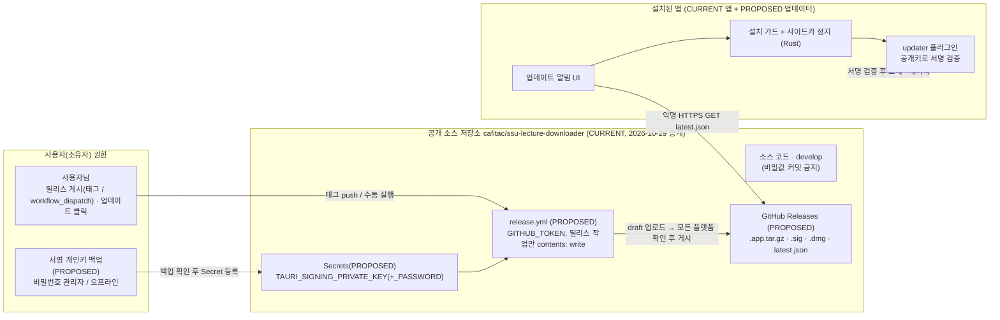

# Context map: update authorities

Status legend: CURRENT = exists today; PROPOSED = this design.

| Authority | Owner | Who may write | Notes |
|---|---|---|---|
| Source repo (public) | user | Claude via PRs to develop (standing grant `merge-ssu-develop`) | merge never publishes; nothing secret committed |
| Release publication | user | `release.yml` `finalize` job only, started by the user's tag/dispatch | drafts invisible to clients; `GITHUB_TOKEN` with `contents: write` on release jobs only |
| Signing private key | user | nobody after generation; read by CI from Secrets | never in repo, app, logs, or `.dev` |
| Public key | repo | AU-PR2 commits it in `tauri.conf.json` | changing it orphans installed apps |
| Install on a machine | that machine's user | updater plugin after the user's click and the guard | no silent install |
