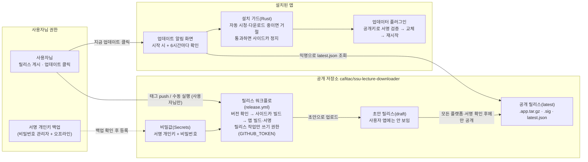
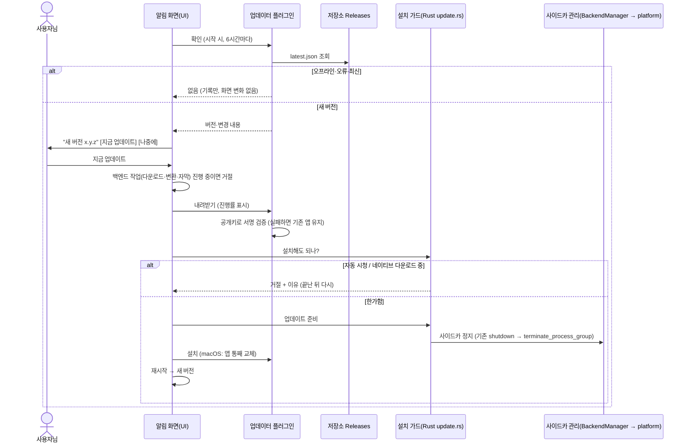
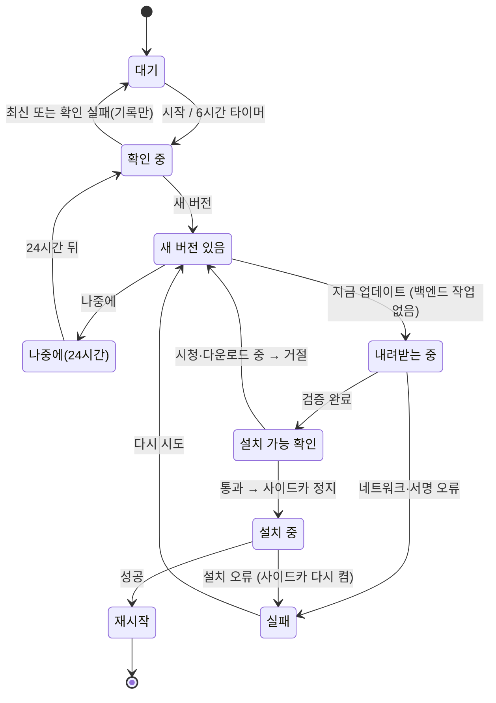
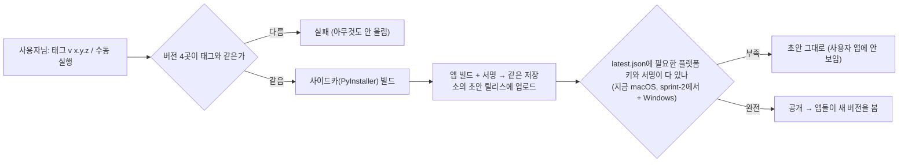

# 설계 검토

- 기능 / 범위: 앱 안에서 새 버전 확인 → 알림 → 클릭 한 번으로 업데이트 (macOS 먼저, Windows는 형제 기능 S2 이후 sprint-2)
- 근거 상태: 현재(CURRENT) / 제안(PROPOSED) / 미결정(OPEN)
- 기준 산출물: `01-context-map.md`, `05-transaction-flows.puml`, `06-state-machines.puml`, `07-consistency-migration.md`, `08-acceptance-trace.md`
- 검토 언어: 한국어
- 표현 원칙: TARGET_OVERVIEW_FIRST

## 이번 수정(2차)에서 바뀐 점

- 소스 저장소를 공개로 바꾸셨기 때문에, 따로 만들려던 공개 릴리스 저장소·전용 토큰(PAT)·저장소 이름 확인 단계가 필요 없어졌어요. 릴리스는 같은 저장소(cafitac/ssu-lecture-downloader)의 Releases에 올리고, 워크플로 기본 토큰(GITHUB_TOKEN)을 릴리스 작업에서만 쓰기 권한으로 써요.
- 사이드카 정지는 이미 병합된 platform 모듈(`platform::terminate_process_group`)을 그대로 써요.
- 범위는 늘지 않았고, 단계가 줄어든 단순화예요.

## 한눈에 보는 최종 구조

- 현재: 새 버전이 나와도 앱은 모르고, 사용자님이 직접 빌드하거나 dmg를 받아 /Applications 앱을 바꿔야 해요. 업데이트 기능·릴리스 배포 경로·서명 키가 모두 없어요(CURRENT).
- 완성 후: 앱이 켜질 때와 6시간마다 저장소 Releases의 `latest.json`을 확인하고, 새 버전이 있으면 알림을 띄워요. "지금 업데이트"를 누르면 내려받기 → 서명 검증 → (자동 시청·다운로드 중이 아니면) 사이드카 정지 → 설치 → 재시작 순서로 진행해요. "나중에"는 24시간 동안 알림을 숨겨요(PROPOSED).
- 안전 경계: 릴리스 게시는 사용자님만(태그 push / 수동 실행). develop 병합은 아무것도 배포하지 않아요. 릴리스는 먼저 초안(draft)으로 올리고, 모든 플랫폼 파일과 서명이 갖춰졌을 때만 공개해요. 서명이 맞지 않으면 설치하지 않고 기존 앱이 그대로 돌아가요. 저장소가 공개라서 서명 개인키는 GitHub Secrets와 사용자님 백업에만 있고, 코드에는 공개키만 들어가요.

## 시각화

### 전체 목표 구조

근거: `01-context-map.md`, `05-transaction-flows.puml`, `07-consistency-migration.md` (전부 PROPOSED)

### 핵심 흐름: 확인부터 재시작까지

근거: `05-transaction-flows.puml` (update-check-and-install)

### 업데이트 화면 상태

근거: `06-state-machines.puml`

### 릴리스 공개 흐름 (보조 안전 자료)

근거: `05-transaction-flows.puml` (release-publication). 플랫폼 하나라도 빠진 `latest.json`이 공개되면 모든 사용자의 확인이 깨지기 때문에, 공개 순서 자체가 안전 설계라서 따로 보여 드려요.

## 구현 순서와 검증 지점

| 순서 | 단위 | 내용 | 확인 | 되돌리기 |
|---|---|---|---|---|
| 0 | (형제) S0-CI, S1-RS-PLATFORM | 병합 완료(develop 30c43a9) — 선행 조건 충족 | — | — |
| 1 | AU-PR1 (AU-DEPS) | Tauri 2.12+ 업그레이드, Rust 1.90 (동작 변화 없음) | CI 전체 + Mac 빌드 + Windows cargo check | PR 되돌리기 |
| 확인 | CP-KEY | **Claude가 서명 키 생성 → 사용자님 백업 확인 → Secrets 등록** | 사람 | — |
| 2 | AU-PR2 (AU-UPDATER-SHELL) | 업데이터·재시작 플러그인, 설정, 권한, 설치 가드, 사이드카 정지 (화면 없음, 비활성) | 계약 테스트 + Rust 테스트 | PR 되돌리기 |
| 3 | AU-PR3 ∥ AU-PR4 | 알림 화면 ∥ 릴리스 워크플로 + 버전 맞추기 스크립트 | 화면 테스트·스크린샷 ∥ 스크립트 테스트 | PR 되돌리기 |
| 확인 | AC5 | 사용자님 허락 하에 초안까지만 시험 실행 | Actions 로그 | 초안 삭제 |
| 확인 | CP-DOGFOOD | **사용자님 Mac: N 수동 설치 → N+1 게시 → 앱에서 업데이트** | 사람 + 로그 | 이전 빌드 재설치 / 더 높은 버전 게시 |
| 4 (sprint-2) | AU-PR5 (AU-WIN-ENTRY) | Windows 항목 추가 (형제 S2의 NSIS 빌드 이후), passive 설치 | Windows CI + 실제 PC | PR 되돌리기 |

- 처음 한 번은 수동 설치가 필요해요: 지금 설치된 0.1.0에는 업데이터가 없어서, 업데이터가 들어간 첫 버전은 저장소 Releases의 dmg로 직접 설치해야 해요(자동 시청 중이 아닐 때).
- 알아 둘 점: 서명하지 않은 Mac 앱이라 업데이트 후 macOS 권한 확인 창이 다시 뜰 수 있어요. 앱은 반드시 /Applications 에 있어야 교체가 돼요. 서명 키를 잃어버리면 설치된 앱은 더 이상 업데이트를 받을 수 없어요.
- 미결정(OPEN): Rosetta 환경의 플랫폼 키, Windows 설치 전 사이드카 정지 방식(sprint-2), Tauri 2.12 업그레이드에서 바뀌는 API.

## 확인이 필요한 결정

- 2차 설계로 진행(승인) / 설계 수정 / 중단 중 하나를 골라 주세요. 승인하시면 함께 작성한 sprint-1 계획(manifest)도 확인해 주세요. 서명 키 백업과 릴리스 게시는 승인과 별개로 그때마다 따로 여쭤봐요.
