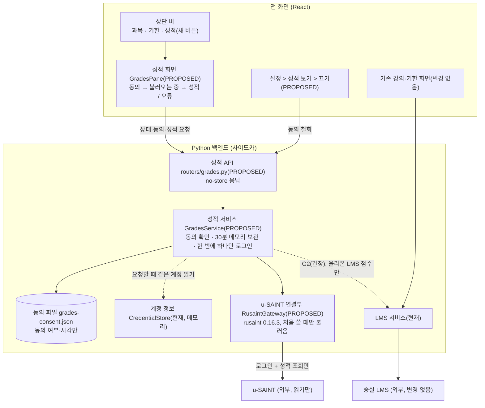
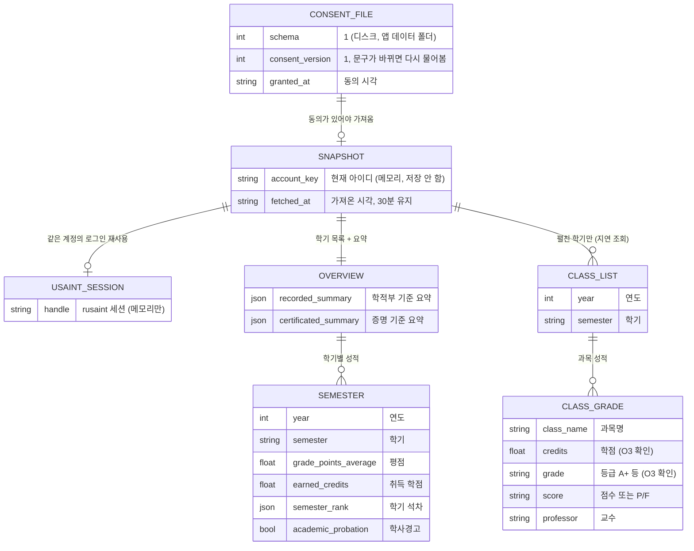
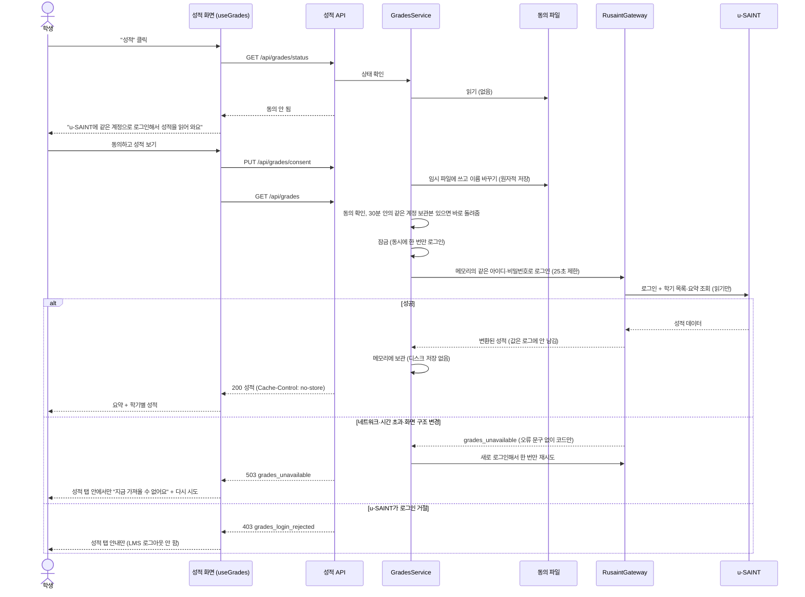
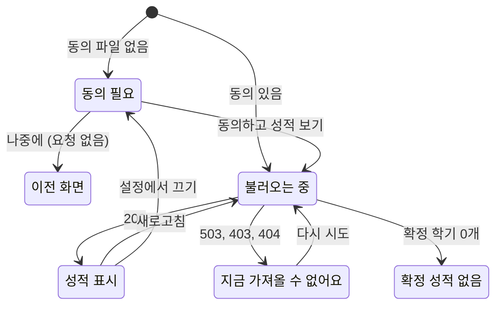

# 설계 검토

- 기능 / 범위: 성적 보기 탭 (u-SAINT 성적 읽기 전용, 동의 후 사용) — G1 필수, G2 LMS 진행 중 점수는 권장
- 근거 상태: 현재(CURRENT) / 제안(PROPOSED) / 미결정(OPEN)
- 기준 산출물: `02-domain-model.puml`, `04-target-schema.dbml`, `05-transaction-flows.puml`, `07-consistency-migration.md`, `08-acceptance-trace.md`
- 검토 언어: 한국어
- 표현 원칙: TARGET_OVERVIEW_FIRST

## 한눈에 보는 최종 구조

- 현재: 앱은 숭실 LMS만 읽어요. 계정 정보는 백엔드 메모리에만 있고, 화면은 "과목"과 "기한" 두 가지예요.
- 완성 후: 상단 바에 "성적" 버튼이 하나 더 생겨요. 처음 누르면 "u-SAINT에 같은 계정으로 로그인해서 성적을 읽어 와요" 안내와 동의 버튼이 나오고, 동의하면 백엔드의 성적 서비스(GradesService)가 메모리의 같은 계정으로 u-SAINT에 로그인해 학기별 성적과 과목 성적을 읽어 와요.
- 안전 경계: 동의 여부만 파일 하나(`grades-consent.json`)에 남고, 성적 값은 메모리에만 있어요(로그·추적 기록·디스크 어디에도 안 남김). u-SAINT가 고장 나도 성적 탭만 "지금 가져올 수 없어요"를 보여 주고 강의 기능과 LMS 로그인은 그대로예요. 앱 이름과 번들 ID(`com.local.ssu-lecture-downloader`)는 바뀌지 않아요.

## 시각화

### 전체 목표 구조

근거: `02-domain-model.puml`, `05-transaction-flows.puml`, `07-consistency-migration.md`

### 목표 데이터 구조 (파일 1개 + 메모리)

근거: `04-target-schema.dbml`

### 핵심 흐름: 동의 → 로그인 → 조회 → 메모리 보관 → 표시, 실패 경로

근거: `05-transaction-flows.puml` Flow 1, 2, 4

### 성적 화면 상태 (화면 안에서만, 저장 안 함)

근거: `05-transaction-flows.puml` Flow 1–5, `07-consistency-migration.md` § Failure isolation

## 화면 구성 (기존 화면 규칙을 그대로 따름)

근거: `frontend/src/components/TopBar.tsx`, `DeadlinesPane.tsx`, `SettingsDialog.tsx`, `styles/tokens.css` (현재). 새 색·새 글자 크기 없음, 기존 토큰과 클래스(`pane-head`, `pane-title`, `pane-sub`, `deadline-note`, `pane-empty`, `chip`, `btn`, `btn-primary`, `btn-ghost`, `week-count`)만 써요.

- 상단 바: "기한" 오른쪽에 같은 모양의 고스트 버튼 "성적" (`aria-pressed`, 눌린 상태는 기존 `is-active` 강조색). 학사경고 같은 배지는 넣지 않아요.
- 화면 전환: `view`가 `'course' | 'deadlines' | 'grades'`가 되고, 성적 화면도 기한처럼 오른쪽 본문(`main`)에 열려요. 왼쪽 과목 목록은 그대로 보이고 선택 표시만 꺼져요.
- 동의 단계 (본문 가운데, 기존 안내 카드 말투):
  - 제목 "성적 보기"
  - 본문 "u-SAINT에 같은 계정으로 로그인해서 성적을 읽어 와요."
  - 목록: "성적은 이 컴퓨터 안에서만 보여 주고, 기록(로그)에 남기지 않아요." / "성적을 바꾸거나 신청하는 일은 하지 않아요. 읽기만 해요." / "설정에서 언제든 끌 수 있어요."
  - 버튼: 주 버튼 "동의하고 성적 보기", 보조 버튼 "나중에"
- 성적 표시:
  - 머리: 제목 "성적" + 새로고침 아이콘 버튼, 보조 줄 "u-SAINT 기준 · 3분 전 업데이트"
  - 안내 줄(`deadline-note` 모양): "이번 학기 성적은 학교가 공개한 뒤에 나타나요."
  - 요약 한 줄 묶음(상자·타일 없이 글자 행): "전체 평점 · 취득 학점 · 신청 학점" (학적부 기준, 증명 기준은 펼쳐서 보기)
  - 학기 묶음(`deadline-group` 모양): 제목 "2025년 1학기" + 과목 수, 한 줄 "평점 · 취득 학점 · 석차 n/N", 학사경고면 `chip-danger` "학사경고"
  - 학기를 펼치면 과목 표: 과목명 · 학점 · 등급 · 점수 · 교수 (처음 펼칠 때 불러오고 그동안 작은 스피너)
- 불러오는 중: `pane-empty` + 스피너 "u-SAINT에서 성적을 불러오는 중…"
- 성적 없음: "아직 확정된 성적이 없어요. 이번 학기 성적은 공개된 뒤에 보여요."
- 오류: `pane-empty` `role="alert"` 제목 "지금 가져올 수 없어요" + 이유 한 줄 + "다시 시도"
  - 연결/시간 초과/구조 변경: "u-SAINT에 연결하지 못했어요. 강의 기능은 그대로 쓸 수 있어요."
  - 로그인 거절: "u-SAINT가 로그인을 받지 않았어요. u-SAINT 웹에서 직접 로그인되는지 확인해 주세요."
  - 새로고침만 실패: 기존 성적은 그대로 두고 보조 줄을 "업데이트하지 못했어요 · 다시 시도"로 바꿔요.
- 설정: 섹션 "성적 보기" — 켜져 있으면 "u-SAINT에서 성적을 읽어 와요" + 작은 버튼 "끄기", 꺼져 있으면 "꺼져 있어요. 상단 '성적'에서 켤 수 있어요."
- G2(권장) 블록: 제목 "이번 학기 진행 중 점수", 칩 "비공식 · 교수님이 올린 점수만", 과목별로 올라온 과제 점수만; 비어 있으면 "아직 올라온 점수가 없어요". Canvas 최종 점수(final_score)는 보여 주지 않아요.
- 검증: 모든 상태를 밝은·어두운 모드에서 렌더하고 스크린샷으로 확인해요 (GR-UI-TAB).

## API 계약 (승인 시 고정, 화면 작업은 이 계약으로 병렬 진행)

근거: `04-target-schema.dbml`, `05-transaction-flows.puml`

| 요청 | 성공 응답 | 실패 |
|---|---|---|
| `GET /api/grades/status` | `{ok, consent: {granted, consent_version, granted_at}, available, current_consent_version: 1, fetched_at}` | — |
| `PUT /api/grades/consent` body `{consent_version: 1}` | status와 같은 모양 | 400 `invalid_consent_version` |
| `DELETE /api/grades/consent` | status (granted false) | — |
| `GET /api/grades?refresh=false` | `{ok, fetched_at, recorded_summary, certificated_summary, semesters[]}` | 409 `grades_consent_required`, 403 `grades_login_rejected`, 503 `grades_unavailable`, 400 `missing_credentials`(기존) |
| `GET /api/grades/classes?year=&semester=ONE\|SUMMER\|TWO\|WINTER&refresh=false` | `{ok, year, semester, classes[]}` | 위와 같음 + 400 `invalid_semester` |
| `GET /api/grades/lms?term_id=` (G2) | `{ok, term_id, courses: [{course_id, course_name, scores: [{assignment_group, assignment_name, score, points_possible}]}]}` | 기존 LMS 오류 코드 (성적 블록 안에서만 표시) |

- 모든 응답 `Cache-Control: no-store`. 성적 오류 코드는 LMS 인증 오류 코드 목록에 들어가지 않아요 → 화면이 앱 전체 로그아웃을 하지 않아요. 백엔드가 옛 버전이라 404면 `grades_unavailable`로 취급해요.

## 구현 순서와 검증 지점

보조 정보예요. 목표 설계는 위 그림이 기준이에요.

| 순서 | 단위 | 내용 | 먼저 끝나야 하는 것 | 검증 |
|---|---|---|---|---|
| 1 | GR-PY-USAINT | rusaint 의존성, `core/grades/`, 성적 API, 동의 파일, 로그아웃·계정 변경 시 비우기 | 형제 작업 S1-PY-MOVE, S1-PY-PLATFORMS 병합 | AC1·AC2·AC3·AC4·AC5·AC9 (pytest, CI) |
| 1' | GR-UI-TAB | 상단 "성적" 버튼, 성적 화면 전 상태, 설정 섹션 | 이 설계 승인 (API 계약) — 1과 병렬로 만들고 1 병합 뒤 병합 | AC1·AC2·AC5 화면 부분, 스크린샷 |
| 2 | GR-PKG-SIDECAR | 사이드카에 rusaint 네이티브 라이브러리 포함 + CI 스모크 | GR-PY-USAINT 병합 | AC6 |
| 확인 | 사용자 확인 | 실제 계정으로 설치본에서 사용 (Wi-Fi 끄기 격리, backend.log 검색 포함) | 1·1'·2 병합 | AC7 |
| 3 | GR-LMS-SCORES (권장) | 이번 학기 LMS 진행 중 점수 블록 | AC7 통과 | AC8 |

- 병렬 작업: 백엔드(1→2)와 화면(1')을 서로 다른 작업자가 동시에 진행할 수 있어요. 공유 파일이 없어요.
- 되돌리기: 각 PR 되돌림. 사용자 단위로는 설정에서 끄기. Windows용 `.dll` 포함은 형제 작업 S2-PR7에서 같은 규칙으로 처리해요.

## 확인이 필요한 결정

1. 성적 데이터를 메모리에만 둘까요, 디스크에도 보관할까요? (추천: 메모리만 — 앱을 다시 켜면 몇 초 걸려 다시 가져오지만 성적이 파일로 남지 않아요. 디스크 보관을 고르면 이 설계를 다시 열어 보관 파일·삭제 시점을 추가해요.)
2. 상단 "성적" 버튼을 처음부터 보이게 할까요, 설정에서 켠 뒤에만 보이게 할까요? (추천: 처음부터 보이게, 누르면 동의 화면)
3. 위 구조·API 계약·PR 순서로 이 설계(산출물 다이제스트는 `../feature.md`의 `Design evidence identity`)를 승인할까요?
