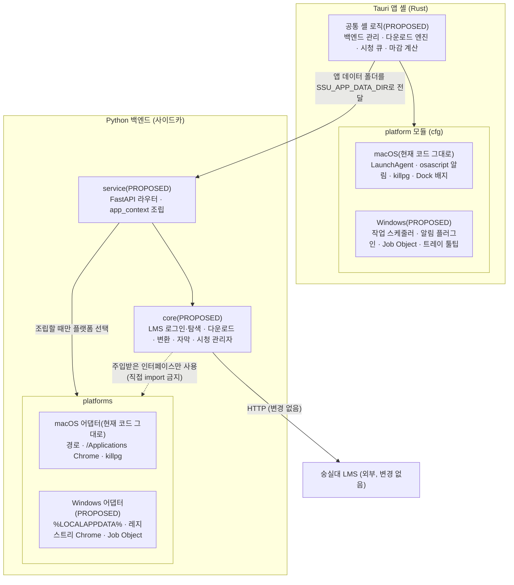
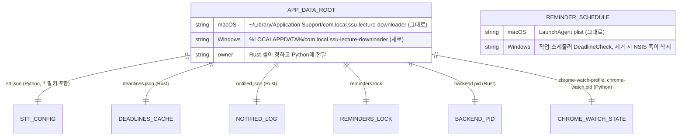
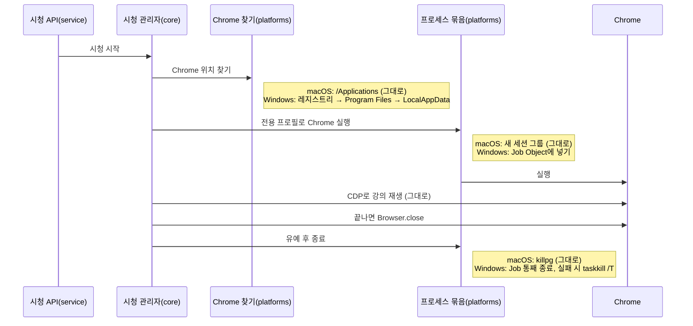
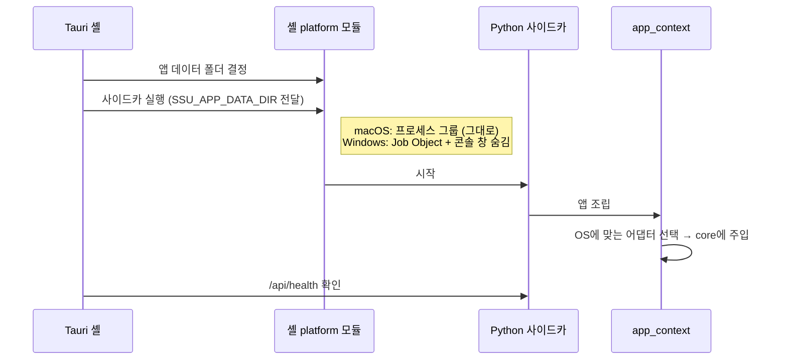

# 설계 검토

- 기능 / 범위: 공통(core) · 플랫폼(platforms) · 서비스(service) 층 분리와 Windows 버전
- 근거 상태: 현재(CURRENT) / 제안(PROPOSED) / 미결정(OPEN)
- 기준 산출물: `02-domain-model.puml`, `04-target-schema.dbml`, `05-transaction-flows.puml`, `07-consistency-migration.md`, `08-acceptance-trace.md`
- 검토 언어: 한국어
- 표현 원칙: TARGET_OVERVIEW_FIRST

## 한눈에 보는 최종 구조

- 현재: Python 백엔드와 Rust 셸 곳곳에 macOS 전용 코드(경로, 프로세스 종료, LaunchAgent, osascript)가 섞여 있어요.
- 완성 후: OS와 무관한 공통 코드는 `core`, OS별 코드는 `platforms`(Python)·`platform`(Rust) 안의 macOS/Windows 어댑터, 조립과 API는 `service`. 공통 코드는 플랫폼을 직접 부르지 못하고 주입받아요.
- 안전 경계: macOS 쪽 코드는 위치만 옮기고 내용은 그대로. 경로·인자·LaunchAgent를 고정하는 특성 테스트와 Intel Mac CI가 모든 PR을 지켜요.

## 시각화

### 전체 목표 구조

근거: `02-domain-model.puml`, `07-consistency-migration.md`

### 목표 데이터 구조 (앱 데이터 파일)

근거: `04-target-schema.dbml`

### 핵심 흐름: 강의 자동 시청의 Chrome 수명

근거: `05-transaction-flows.puml` (auto-watch-chrome-lifecycle)

### 앱 시작: 앱 데이터 폴더 한 곳

근거: `05-transaction-flows.puml` (startup-app-data-handoff)

## 구현 순서와 검증 지점

| 단계 | PR | 내용 | 확인 |
|---|---|---|---|
| S0 | PR1 | Intel Mac CI + macOS 고정 특성 테스트 | CI |
| S1 | PR2 | Python `core`/`service`로 파일 이동 + import 규칙 검사 | CI |
| S1 | PR3 | Python `platforms` 추출 (macOS 어댑터만) | CI |
| S1 | PR4 | Rust `platform` 모듈 (macOS 그대로 + Windows 빈 틀이 컴파일됨) | CI(Mac+Windows 컴파일) |
| 확인 | — | **사용자님이 새 Mac 앱 설치 후 확인** (시청 중 아닐 때) | 사람 |
| S2 | PR5 ∥ PR6 | Windows 어댑터 Python ∥ Rust (동시 진행) | Windows CI 테스트 |
| S2 | PR7 | Windows 설치 파일 빌드 + 사이드카 health 확인 + 산출물 업로드 | Windows CI |
| S3 | — | 친구 Windows PC 실제 확인 | 사람 |

- 되돌리기: 각 PR은 따로 되돌릴 수 있고, Mac 앱은 바탕화면 `SSU-Lecture-Downloader.dmg` 로 언제든 원래대로.
- 미결정(OPEN): Windows의 VC++ 런타임 필요 여부, curl_cffi 비동기 동작, Windows 11 스마트 앱 컨트롤 차단 가능성 — S2/S3에서 확인.

## 확인이 필요한 결정

- 이 설계로 진행(승인) / 설계 수정 / 중단 중 하나를 골라 주세요.
