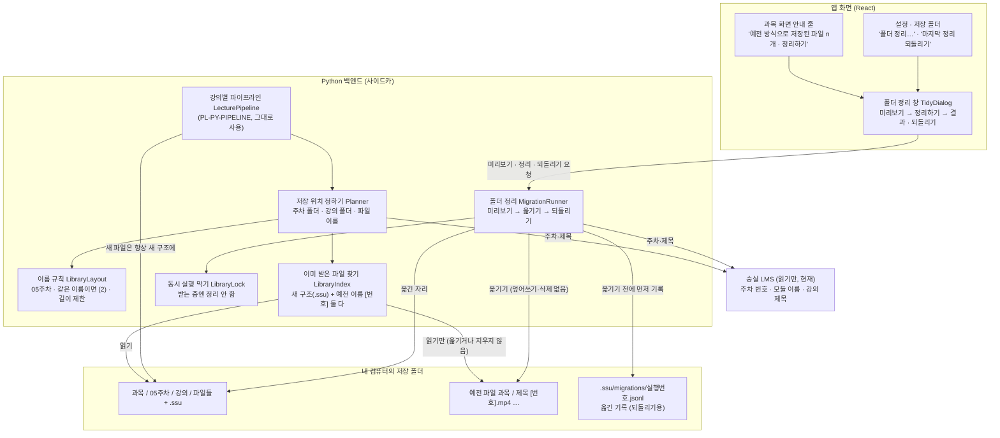
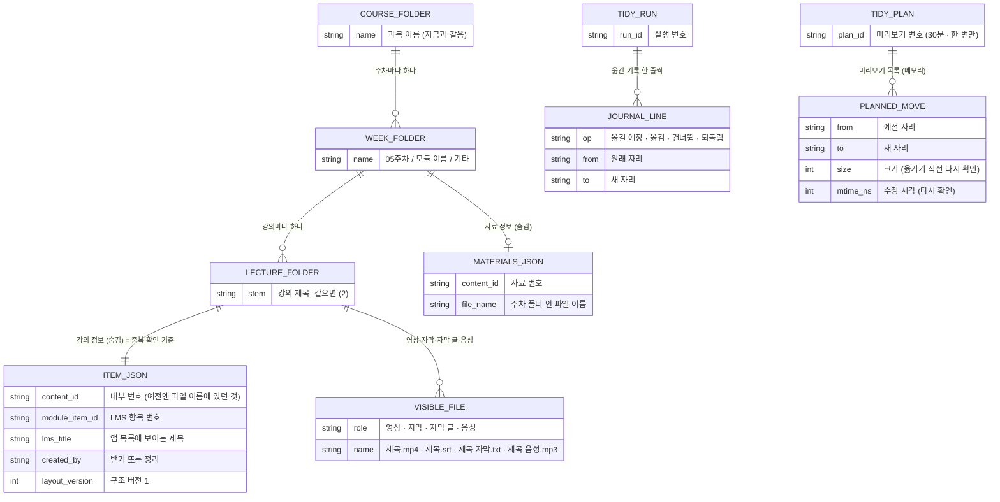
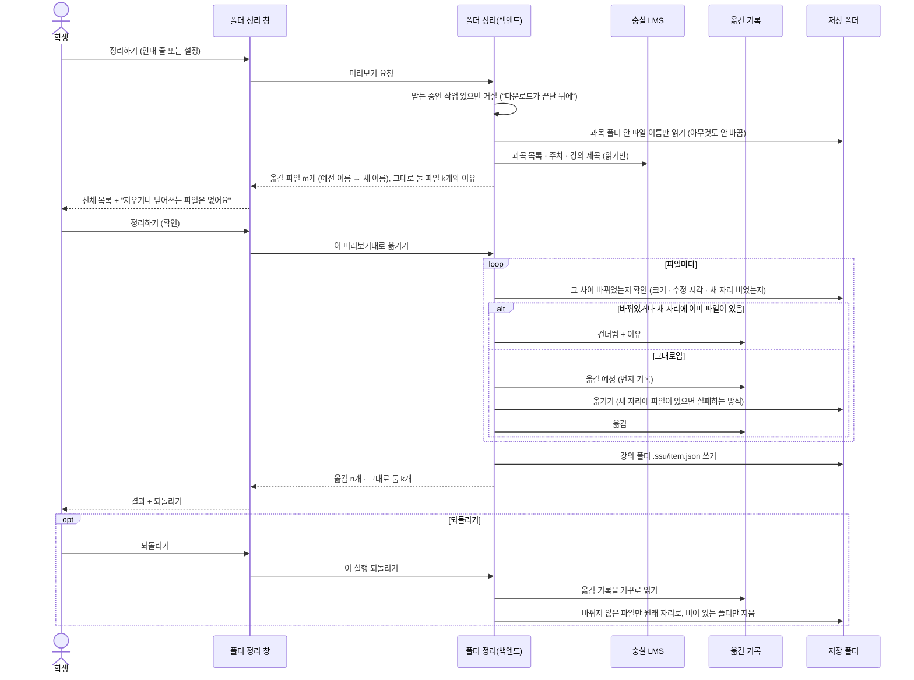
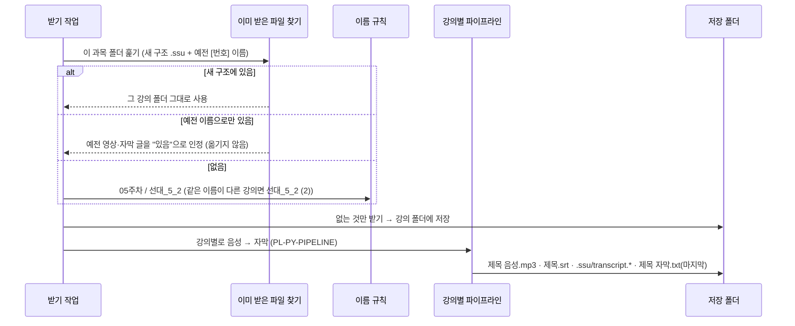
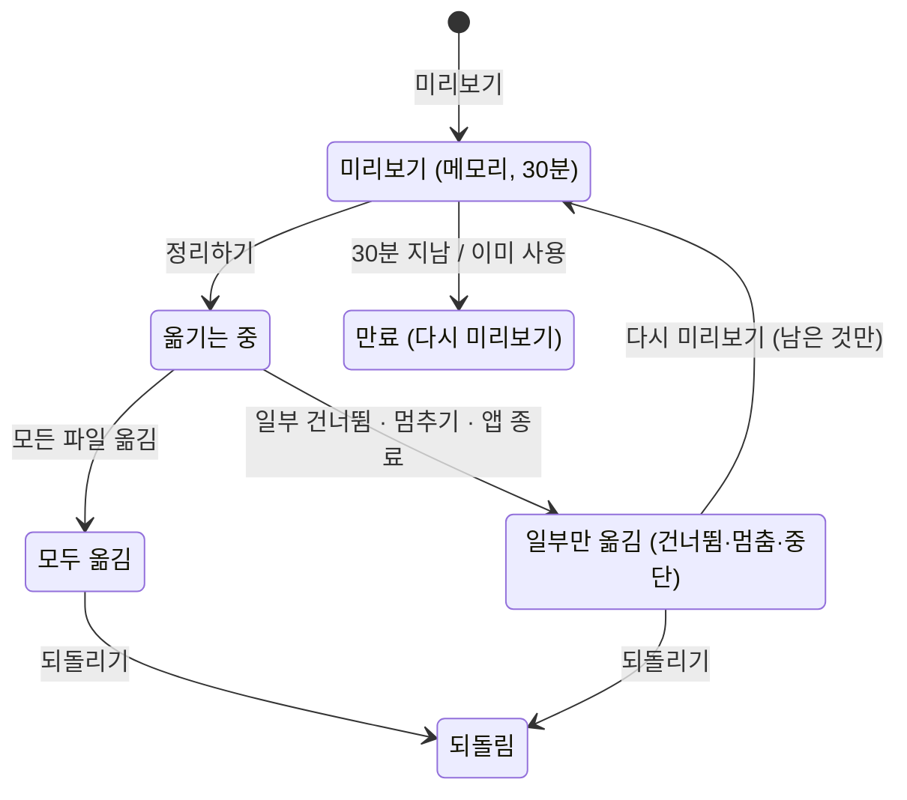

# 설계 검토

- 기능 / 범위: 받은 파일을 "과목 → 주차 → 강의" 폴더로 저장하고, 앱이 쓰는 정보는 숨김 폴더(`.ssu`)에 두고, 이미 받은 파일은 미리보기를 보여 준 뒤 새 구조로 옮기기(되돌리기 가능)
- 근거 상태: 현재(CURRENT) / 제안(PROPOSED) / 미결정(OPEN)
- 기준 산출물: `02-domain-model.puml`, `04-target-schema.dbml`, `05-transaction-flows.puml`, `07-consistency-migration.md`, `08-acceptance-trace.md`
- 검토 언어: 한국어
- 표현 원칙: TARGET_OVERVIEW_FIRST

## 한눈에 보는 최종 구조

- 현재: 과목 폴더 하나에 모든 파일이 섞여 있어요. 이름 끝에 `[68e66b6c1b816]` 같은 앱 내부 번호가 붙고, 자막 글은 `.transcript.txt`, `.md`, `.json` 세 개로 나뉘어 보여요. 예전에 받은 강의는 자막 글이 `.txt` 하나뿐이에요.
- 완성 후: 과목 폴더 안에 `05주차` 같은 주차 폴더, 그 안에 강의마다 폴더가 하나씩 생겨요. 강의 폴더에는 열어 볼 파일만 보여요 — 영상, 영상과 이름이 같은 자막(플레이어가 자동으로 불러와요), 자막 글, 음성. 내부 번호와 `.md`/`.json`은 숨김 폴더 `.ssu` 안으로 들어가요.
- 이미 받은 파일: 앱이 예전 이름도 알아보기 때문에 **다시 받지 않아요.** "정리하기"를 누르면 옮길 목록을 먼저 다 보여 주고, 확인한 뒤에만 옮겨요. 지우거나 덮어쓰는 일은 없고, 옮긴 기록이 남아서 "되돌리기"로 원래 자리로 돌릴 수 있어요.
- 순서: 지금 진행 중인 "강의별 파이프라인"(PL-PY-PIPELINE)이 먼저 합쳐진 뒤에 시작해요. 그 파이프라인을 그대로 쓰고, 파일 위치를 정하는 부분만 바꿔요.

```
선형대수 (대면+사전녹화) (2150151201)/
  05주차/
    선대_5_2/
      선대_5_2.mp4          ← 영상
      선대_5_2.srt          ← 자막 (영상과 같은 이름이라 자동으로 불러와요)
      선대_5_2 자막.txt     ← 자막 글
      선대_5_2 음성.mp3     ← 음성
      .ssu/                 ← 숨김: 강의 정보(item.json), transcript.md, transcript.json
    선형대수 5주차 자료.pdf ← 강의 자료 (주차 폴더 바로 아래, Q2)
    .ssu/materials.json     ← 숨김: 자료 정보
```

## 시각화

### 전체 목표 구조

근거: `02-domain-model.puml`, `05-transaction-flows.puml` Flow 1–4, `07-consistency-migration.md`



### 목표 데이터 구조 (파일과 메모리, 데이터베이스 없음)

근거: `04-target-schema.dbml`



### 핵심 흐름: 미리보기 → 확인 → 옮기기 (기록 먼저)

근거: `05-transaction-flows.puml` Flow 2, Flow 3



### 함께 보는 흐름: 새로 받을 때 (이미 있는 파일은 다시 안 받음)

근거: `05-transaction-flows.puml` Flow 1



### 정리 한 번의 상태

근거: `07-consistency-migration.md` § Migration run



## 이름이 이렇게 바뀌어요 (실제 저장 폴더 예)

| 지금 | 정리 후 |
|---|---|
| `선대_5_2 [68e66b6c1b816].mp4` | `05주차/선대_5_2/선대_5_2.mp4` |
| `선대_5_2 [68e66b6c1b816].srt` | `05주차/선대_5_2/선대_5_2.srt` |
| `선대_5_2 [68e66b6c1b816].txt` (예전 자막 글) | `05주차/선대_5_2/선대_5_2 자막.txt` |
| `선대_6_1 [68feeb3f3b6dd].transcript.txt` | `06주차/선대_6_1/선대_6_1 자막.txt` |
| `선대_6_1 [68feeb3f3b6dd].transcript.md`, `.json` | `06주차/선대_6_1/.ssu/transcript.md`, `.json` (숨김) |
| `Ui_6주차_03 [6ac8fceb2f43d].mp3` | `06주차/Ui_6주차_03/Ui_6주차_03 음성.mp3` |
| `7주차 1강 감성지능 리더십 [65dbf62460d5a] (2).mp4` (같은 강의 두 번째 사본) | `07주차/7주차 1강 감성지능 리더십/7주차 1강 감성지능 리더십 (2).mp4` (Q5) |
| `5주차 타인 인식 … [660650405b034].file` (강의 자료) | `05주차/5주차 타인 인식 ….pdf` (LMS가 알려 주는 확장자가 있으면) |
| `UI디자인_1주차_202602 [canvas-4732412].pdf` (페이지 첨부) | `01주차/UI디자인_1주차_202602.pdf` (제목의 "1주차") |
| 받다 만 `.part`, 앱이 받지 않은 파일, 이번 학기 목록에 없는 과목 폴더 | 그대로 둬요 (목록에 이유와 함께 보여요) |

- 주차 폴더 번호는 LMS의 주차 번호를 먼저 쓰고, 없으면 모듈 이름의 "5주차"에서 읽어요. 위 표의 주차는 실제 LMS 값에 따라 달라질 수 있어요.
- 이름은 앱 목록에 보이는 강의 제목을 써요(Q3). 위 예는 지금 파일 이름의 제목을 그대로 적었어요.

## 화면과 문구

| 자리 | 상태 | 문구 / 버튼 |
|---|---|---|
| 과목 화면 위 안내 줄 | 이 과목에 예전 방식 파일이 있음 | "이 과목에 예전 방식으로 저장된 파일이 {n}개 있어요. 주차·강의별 폴더로 정리할 수 있어요." [정리하기] [나중에] |
| 설정 · 저장 폴더 | 항상 | [폴더 정리…] (받는 중이면 꺼짐: "다운로드가 끝나면 정리할 수 있어요") |
| 설정 · 저장 폴더 | 되돌릴 기록이 있음 | [마지막 정리 되돌리기] |
| 폴더 정리 창 | 확인 중 | "옮길 파일을 확인하고 있어요…" |
| 폴더 정리 창 | 미리보기 | "파일 {m}개를 주차·강의별 폴더로 옮겨요. 지우거나 덮어쓰는 파일은 없어요." · 과목 › 주차 › 강의별로 묶은 목록 (예전 이름 → 새 이름) · 접힌 "그대로 두는 파일 {k}개" · "열려 있는 파일도 옮겨져요. 재생 중인 영상은 계속 재생되지만, 다시 열 때는 새 폴더에서 열어 주세요." · [취소] [정리하기] |
| 폴더 정리 창 | 옮길 것 없음 | "정리할 파일이 없어요." [닫기] |
| 폴더 정리 창 | 옮기는 중 | "정리하는 중… {done}/{total}" [멈추기] (지금 파일까지만 옮기고 멈춰요) |
| 폴더 정리 창 | 결과 | "{moved}개를 옮겼어요." (+ "{skipped}개는 그대로 뒀어요.") [폴더 열기] [되돌리기] [닫기] |
| 폴더 정리 창 | 되돌린 결과 | "{restored}개를 원래 자리로 돌려놨어요." (+ "{skipped}개는 그대로 뒀어요.") |

그대로 두는 이유 문구:

| 코드 | 문구 |
|---|---|
| `destination_exists` | 같은 이름의 파일이 이미 있어요 |
| `unknown_file` | 이 앱이 받은 파일인지 알 수 없어요 |
| `partial_download` | 받다 만 파일이에요 |
| `course_not_matched` | 이번 학기 과목 목록에 없는 폴더예요 |
| `duplicate_transcript` | 같은 강의의 자막 글이 이미 있어요 (예전 파일) |
| `source_changed` | 미리보기 뒤에 파일이 바뀌었어요 |
| `source_missing` | 미리보기 뒤에 파일이 없어졌어요 |
| `not_a_regular_file` | 폴더나 바로가기는 옮기지 않아요 |
| `in_use` | 다른 앱이 쓰고 있어요 (Windows) |
| `path_too_long` | 경로가 너무 길어요 (Windows) |

오류 문구: `library_busy` "다운로드가 끝난 뒤에 정리할 수 있어요." · `library_tidy_running` "폴더를 정리하는 중이에요. 끝나면 받을 수 있어요." · `tidy_plan_expired` "미리보기가 오래돼서 다시 확인했어요." (창이 스스로 다시 미리보기)

## 내부 API 계약 (승인 시 고정, 화면 작업은 이 계약으로 병렬 진행)

앱 화면과 백엔드 사이의 내부 API예요(외부에 공개하지 않음). 모두 추가만 해요.

| 요청 | 응답 / 결과 |
|---|---|
| `GET /api/library/legacy-summary?output_dir=` | `{ok, root, legacy_file_count, course_count, courses:[{folder, legacy_file_count}]}` — 로그인 없이 폴더만 훑음 |
| `GET /api/courses/{id}` (현재) | 추가 `legacy_file_count`; `downloaded_path`는 새 구조·예전 이름 둘 다에서 찾음 |
| `POST /api/download/canvas-file` (현재) | 요청에 선택 `module_name`, `week_position` 추가 |
| `POST /api/library/tidy/plan/jobs {output_dir}` | 작업 결과 `{plan_id, expires_at, move_count, skip_count, moves:[{course, week_folder, lecture_stem, from, to, role}], skips:[{path, reason}], open_files_note}` |
| `POST /api/library/tidy/apply/jobs {plan_id}` | 작업 진행 `{stage:"tidy_moving", done, total}`; 결과 `{run_id, moved, skipped, skips, undo_available}` |
| `POST /api/library/tidy/undo/jobs {run_id}` | 결과 `{run_id, restored, skipped, skips}` |
| `GET /api/library/tidy/runs?output_dir=` | `{runs:[{run_id, at, moved, undo_available}]}` (최신 순) |
| 작업 상태 · 취소 | 기존 방식 그대로 (`GET …/{job_id}`, `POST …/{job_id}/cancel`) |
| 오류 | 409 `library_busy`, 409 `library_tidy_running`, 409 `tidy_plan_expired` |

- `plan_id`는 미리보기 결과에서만 얻어요. 정리하기는 그 `plan_id`로만 할 수 있어요.

## 전달 계획 참고 (보조 정보)

목표 설계는 위 그림이 기준이에요. 아래는 구현 순서예요.

| 순서 | PR 단위 | 담당 설계 범위 | 검증 / 관찰 | 롤백 경계 |
|---|---|---|---|---|
| 0 | (선행) PL-PY-PIPELINE, PL-UI-STATES | 강의별 파이프라인 — 다른 작업, 합쳐질 때까지 기다림 | 그쪽 기록 | — |
| 1 | LAYOUT-PY-PATHS | 이름 규칙, 숨김 정보, 이미 받은 파일 찾기(새 구조 + 예전 이름), 받기·자막 저장 위치 | AC1–AC6, AC14 (pytest, CI) | PR 되돌리기 (예전 파일은 계속 인식) |
| 2 | LAYOUT-PY-MIGRATION | 미리보기·옮기기·기록·되돌리기, 동시 실행 막기, 내부 API | AC7–AC11 (임시 폴더 테스트, 고장 주입) | 실행마다 되돌리기 / PR 되돌리기 |
| 2' | LAYOUT-UI-TIDY | 안내 줄, 설정 항목, 폴더 정리 창, 첨부 파일 주차 전달 (2와 병렬로 만들고 2 병합 뒤 병합) | AC11 화면, AC12, 스크린샷 | PR 되돌리기 |
| 확인 | 사용자 확인 | 설치본으로 실제 저장 폴더 미리보기 → 정리 → 플레이어 자막 → 다시 받기 안 함 → 되돌리기 한 번 → 다시 정리 | AC13 | 되돌리기 / 이전 설치본 |

## 확인이 필요한 결정

1. (Q1) 모듈 이름에 주차 숫자가 없을 때 (예: "오리엔테이션") 폴더 이름을 어떻게 할까요? 추천: 모듈 이름 그대로 — 앱 목록에서 묶여 보이는 이름과 같아요. 아니면 "기타"로 모아요.
2. (Q2) 강의 자료(PDF 등)는 어디에 둘까요? 추천: 주차 폴더 바로 아래 — 파일 하나라 폴더를 또 만들면 번거로워요. 아니면 강의처럼 자기 폴더를 만들어요.
3. (Q3) 강의 폴더·파일 이름은 앱 목록에 보이는 강의 제목으로 할까요? 추천: 예 — 지금은 영상 서버가 주는 제목을 써서 목록과 다를 때가 있어요.
4. (Q4) 정리하기는 어디서 제안할까요? 추천: 과목을 열었을 때 예전 파일이 있으면 위에 안내 줄 + 설정에 "폴더 정리…". 아니면 설정에만 둬요.
5. (Q5) 같은 강의를 두 번 받은 사본(`… (2).mp4`)은? 추천: 같은 강의 폴더 안으로 `제목 (2).mp4`로 같이 옮겨요. 아니면 그대로 둬요.
6. (Q6) 이번 학기 과목인데 LMS 목록에서 사라진 강의의 파일은? 추천: `기타/제목/`으로 옮겨요. 아니면 그대로 둬요. (과목 자체를 못 찾는 폴더는 항상 그대로 둬요.)
7. 위 구조·이름 규칙·내부 API 계약·PR 순서로 이 설계(산출물 다이제스트는 `../feature.md`의 진행 기록)를 승인할까요? 승인해도 구현은 강의별 파이프라인(PL-PY-PIPELINE)이 합쳐진 뒤에 시작해요.
