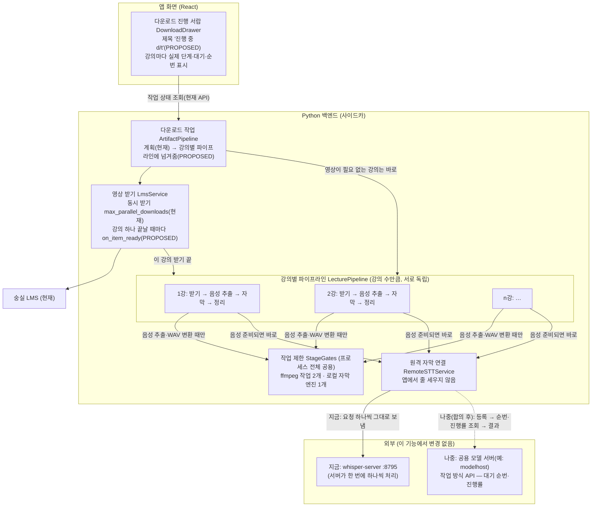
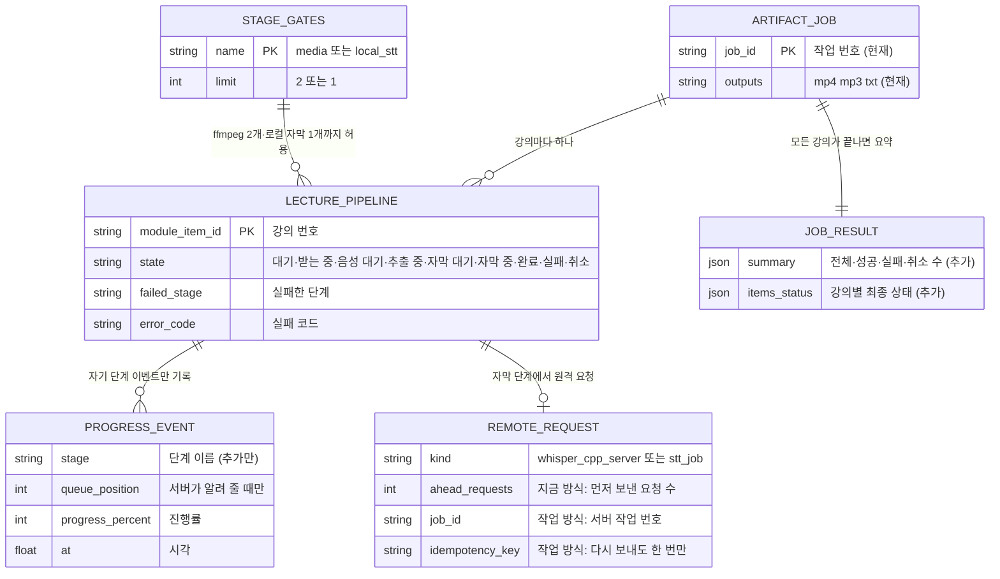
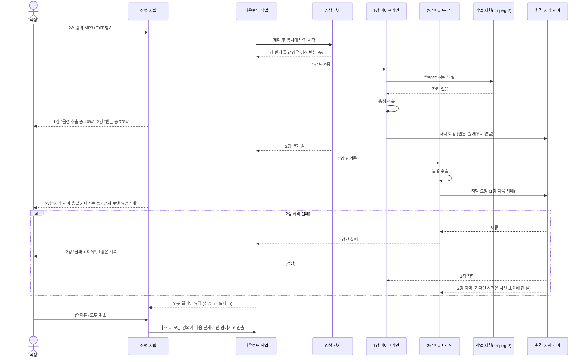
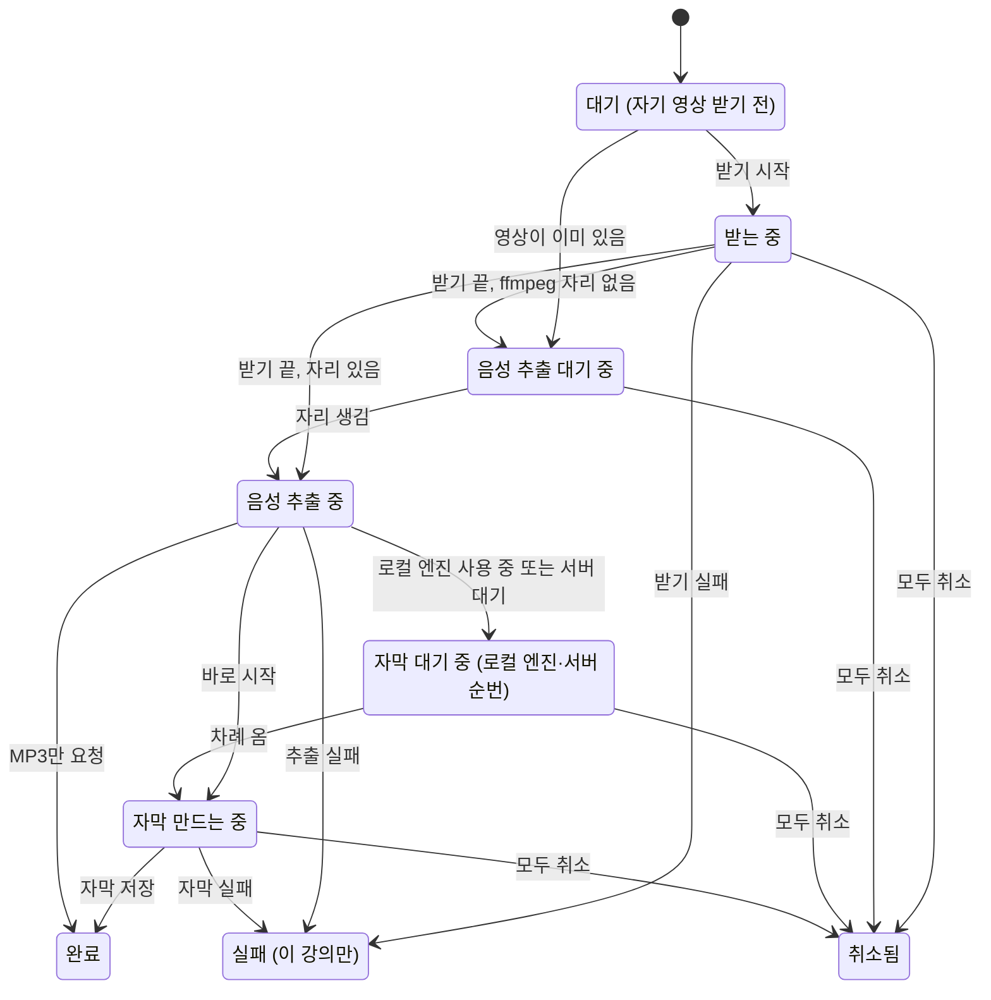

# 설계 검토

- 기능 / 범위: 강의별 독립 파이프라인 (받기 → 음성 추출 → 자막을 강의마다 순서대로, 강의끼리는 동시에) + 원격 자막 "작업 방식" 연결부 초안
- 근거 상태: 현재(CURRENT) / 제안(PROPOSED) / 미결정(OPEN)
- 기준 산출물: `02-domain-model.puml`, `04-target-schema.dbml`, `05-transaction-flows.puml`, `07-consistency-migration.md`, `08-acceptance-trace.md`, `remote-stt-job-protocol.md`
- 검토 언어: 한국어
- 표현 원칙: TARGET_OVERVIEW_FIRST

## 한눈에 보는 최종 구조

- 현재: 강의 여러 개를 고르면 영상을 **모두** 받은 뒤에야 후처리가 시작되고, 후처리(음성 추출·자막)는 강의 하나씩만 돌아요. 한 강의가 실패하면 나머지도 멈추고, 영상 하나라도 못 받으면 나머지 강의의 후처리 자체가 안 돌아요. 받기가 끝난 강의는 후처리 차례를 기다리는 동안 "받는 중 · 100%"로 보여요.
- 완성 후: 강의마다 자기 순서(받기 → 음성 추출 → 자막 → 정리)를 따로 밟아요. 1강 영상이 다 받아지면 2강이 아직 받는 중이어도 1강은 바로 음성 추출을 시작하고, 음성이 준비된 강의는 바로 자막 서버로 보내요. 이 컴퓨터의 CPU를 쓰는 일만 제한해요: 음성 추출 등 ffmpeg 작업 동시에 2개, 이 컴퓨터에서 도는 자막 엔진 1개. 원격 자막 서버로 보내는 요청은 앱이 줄 세우지 않아요 — 순서는 서버가 정해요.
- 안전 경계: 한 강의가 실패해도 그 강의만 "실패"로 끝나고 나머지는 끝까지 가요. "모두 취소"는 어느 단계에 있든 전부 멈춰요. 원격 서버에서 기다린 시간 때문에 자막이 시간 초과로 실패하지 않아요. 새 파일·새 저장소는 없고, 화면이 받는 응답 모양은 그대로(추가만)예요. Mac Studio와 공용 모델 서버(modelhost)는 이 기능에서 건드리지 않아요.

## 시각화

### 전체 목표 구조

근거: `02-domain-model.puml`, `05-transaction-flows.puml` Flow 1, `07-consistency-migration.md` § Concurrency model

### 목표 데이터 구조 (모두 메모리, 새 파일 없음)

근거: `04-target-schema.dbml`

### 핵심 흐름: 강의별로 따로 진행, 한 강의 실패는 그 강의만

근거: `05-transaction-flows.puml` Flow 1, Flow 2, Flow 3

### 강의 한 개의 상태 (메모리에서만, 저장 안 함)

근거: `02-domain-model.puml` LecturePipeline, `04-target-schema.dbml` lecture_state

## 화면 문구 (진행 서랍의 한 줄)

| 상황 | 지금 보이는 것 | 바뀐 뒤 |
|---|---|---|
| 받기 끝, 음성 추출 차례 기다림 | 받는 중 · 100% | 음성 추출 대기 중 |
| 음성 추출 중 | 음성 추출 중 · n% | 같음 |
| 음성 끝, 자막 차례 기다림 (로컬 엔진 사용 중) | 받는 중 · 100% 또는 자막 만드는 중 0% | 자막 대기 중 |
| 지금 방식 원격: 먼저 보낸 요청이 서버에 있음 | 자막 만드는 중 (원격) · 5% (멈춘 것처럼 보임) | 자막 서버 응답 기다리는 중 · 먼저 보낸 요청 n개 |
| 작업 방식 원격: 서버 대기열 | (없음) | 자막 대기 중 (n번째) |
| 작업 방식 원격: 서버가 잠시 미룸(429) | (없음) | 자막 대기 중 (서버가 잠시 미룸) |
| 원격 처리 중, 서버가 진행률을 알려 줌 | — | 자막 만드는 중 (원격) · n% (추정치면 "약 n%") |
| 서랍 제목 | 받는 중 d/t | 진행 중 d/t |

- 전체 진행 막대: 강의마다 받기 40 · 음성 20 · 자막 40 비중으로 계산 (요청한 결과물만 반영).
- 새 실패 코드 문구: `stt_remote_job_lost` "자막 서버에서 작업을 찾지 못했어요. 다시 시도해 주세요.", `stt_remote_upload_too_large` "음성 파일이 서버 허용 크기보다 커요.", `stt_remote_bad_request` "자막 서버가 이 음성 파일을 받지 않았어요."

## 진행 이벤트 계약 (승인 시 고정, 화면 작업은 이 계약으로 병렬 진행)

모든 이벤트에 현재처럼 `index`, `total`, `module_item_id`, `title`이 붙고, 새로 `at`(초 단위 시각)이 붙어요. 아래는 **추가**되는 단계예요. 기존 단계 이름과 의미는 그대로예요.

| stage | 언제 | 추가 필드 |
|---|---|---|
| `artifact_item_queued` | 계획 직후 강의마다 한 번 | — |
| `audio_waiting` | ffmpeg 자리를 바로 못 얻었을 때 한 번 | — |
| `transcript_waiting` | 자막 차례를 기다릴 때 | `reason` (`local_engine` / `server_busy` / `server_deferred`), `ahead_requests`, `retry_after_seconds` |
| `transcript_queued` | 작업 방식 서버가 대기 중이라고 알릴 때 (갱신) | `queue_position`, `job_id` |
| `transcript_progress` (현재 단계) | 처리 중 | 선택 `progress_estimated` |
| `artifact_item_done` | 강의 하나가 모두 끝남 | — |
| `artifact_item_failed` | 강의 하나가 실패 | `error_code`, `failed_stage` |
| `artifact_item_cancelled` | 취소로 끝남 | — |

- 작업 응답: `status`, `error_code` 의미 그대로 (`partial_failure`는 이미 화면 문구가 있음). `result`에 `summary`, `items_status`가 추가돼요.
- 옛 화면 + 새 백엔드: 모르는 단계는 무시, `artifact_item_failed`는 이름에 failed가 있어 실패로 표시돼요. 새 화면 + 옛 백엔드: 대기 상태를 `download_done`/`audio_done`에서 스스로 계산해요.

## 원격 자막: 지금 방식과 나중 방식

| | 지금 방식 (`whisper_cpp_server`, 그대로 유지) | 나중 방식 (`stt_job`, 공용 모델 서버와 합의 후) |
|---|---|---|
| 요청 | 강의마다 음성 전체를 한 번에 보내고 응답을 기다림 | 등록 → 작업 번호 → 상태 조회 → 결과 받기 |
| 줄 세우기 | 앱은 안 함, 서버가 한 번에 하나씩 처리 | 서버 대기열 (우선순위·공정 분배는 서버 몫) |
| 기다린 시간 | 응답 대기 한도를 "20분 × (1 + 먼저 보낸 요청 수)", 최대 4시간으로 늘림 | 대기 중에는 한도 없음, 처리 시간에만 한도 |
| 순번·진행률 | 순번 모름 → "먼저 보낸 요청 n개"만 표시 | 서버가 알려 주는 순번·진행률 표시 |
| 긴 강의 나누기 | 앱이 하지 않음 (지금과 같음) | 서버가 나눔, 앱은 나누지 않음 |
| 단점 | 다른 사용처가 같은 서버를 쓰면 한도를 넘을 수 있음, 서버가 멈추면 늦게 알아챔 | 서버 쪽 구현이 먼저 필요 |

- 나중 방식의 요청·응답 모양 초안은 `remote-stt-job-protocol.md`에 따로 있어요 (공용 모델 서버 쪽 검토용).

## 전달 계획 참고 (보조 정보)

목표 설계는 위 그림이 기준이에요. 아래는 구현 순서예요.

| 순서 | PR 단위 | 담당 설계 범위 | 검증 / 관찰 | 롤백 경계 |
|---|---|---|---|---|
| 1 | PL-PY-PIPELINE | 강의별 파이프라인, 작업 제한, 실패 격리, 취소, 진행 이벤트, 지금 방식 원격 대기 한도 | AC1–AC6, AC8 (pytest, CI) | PR 되돌리기 |
| 1' | PL-UI-STATES | 대기 상태·순번 문구, 서랍 제목, 전체 진행률 계산 (1과 병렬로 만들고 1 병합 뒤 병합) | AC7, AC8 화면 부분, 스크린샷 | PR 되돌리기 |
| 확인 | 사용자 확인 | 설치본에서 강의 3개 TXT, 겹쳐 진행·실패 격리·모두 취소 | AC10 | 이전 설치본 |
| 2 | STT-JOB-PROVIDER | 작업 방식 원격 연결부 (`stt_job`), 설정 선택지 | AC9 — 프로토콜 합의(AC11) 뒤에만 시작 | 설정에서 지금 방식으로 되돌리기 / PR 되돌리기 |
| 외부 | EXT-MODELHOST-STT | 공용 모델 서버의 STT 구현 (이 기능 밖, 소유자 + interview-coach 결정) | 질문 목록: `07-consistency-migration.md` 마지막 절 | — |

## 확인이 필요한 결정

1. 지금 방식(`whisper_cpp_server`)에서도 앱이 줄 세우지 않고 강의별 요청을 바로 보내고, 응답 대기 한도만 "20분 × (1 + 먼저 보낸 요청 수), 최대 4시간"으로 늘릴까요? (추천: 예 — 서버가 순서대로 처리하니 전체 시간은 같고, 대기 때문에 실패하지 않아요. 대신 서버가 멈추면 늦게 알아채요. 아니오를 고르면 이 방식에서만 원격 요청을 하나씩 보내요.)
2. 진행 서랍 제목을 "받는 중 d/t" 대신 "진행 중 d/t"로 바꿀까요? (추천: 예 — 음성 추출·자막까지 포함하니까요.)
3. 원격 자막 작업 방식 초안(`remote-stt-job-protocol.md`)을 공용 모델 서버(modelhost) 쪽 검토에 보낼까요? 반복 구간 다시 인식은 서버가 맡는 쪽을 추천해요 (서버가 이미 긴 음성을 나누니까요).
4. 위 구조·이벤트 계약·PR 순서로 이 설계(산출물 다이제스트는 `../feature.md`의 진행 기록)를 승인할까요?
